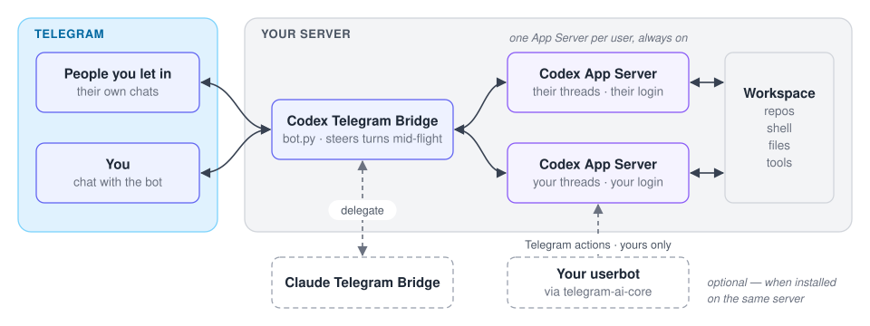

<div align="center">

# Codex Telegram Bridge

**A persistent Codex session on your server, driven from a Telegram chat.**

[Install](#install-in-three-steps) · [Commands](#commands) · [Several users](#letting-other-people-in) · [With other Telegram AI parts](#together-with-the-rest-of-telegram-ai) · [Troubleshooting](#troubleshooting)

Part of **[Telegram AI](https://github.com/maleon17/telegram-ai)** — Claude Code and Codex from Telegram, on your own subscription.

</div>

---

You write to a bot; Codex works on the machine where your projects live — with its shell, files and tools — and reports back in the chat. It runs on your ChatGPT/Codex subscription through the official Codex CLI, not on a metered API key.

<picture>
  <source media="(prefers-color-scheme: dark)" srcset="docs/architecture-dark.svg">
  
</picture>

Unlike wrappers that start a fresh `codex exec` for every message, each user gets a long-lived Codex App Server, so conversations are real, resumable threads.

## What you get

- **Real sessions** — `/new`, `/sessions`, `/resume`; threads survive restarts.
- **Watch it work** — a live progress card while Codex works, then the answer as a normal message.
- **Steer mid-turn** — a message sent while Codex is busy is added to the running turn, not queued.
- **Stop and compact** — `/stop` interrupts the turn for real, `/compact` shrinks a long thread.
- **Control from the phone** — model, reasoning effort, sandbox and working folder per user.
- **Files both ways** — send photos and documents in; Codex sends results back as attachments.
- **Your subscription, your limits** — `/usage` shows tokens, context and plan limits with reset times.
- **Several users, fully isolated** — each with their own Codex account, threads and limits.
- **Safe operations** — restarts wait for running answers; `/update` updates from Git.
- **No extra dependencies** — the bot itself uses only Python's standard library.

## Install in three steps

**You need:** a Linux server with `systemd` and Python 3.10+, the [Codex CLI](https://developers.openai.com/codex/cli/), and a bot token from [@BotFather](https://t.me/BotFather). Your numeric Telegram ID comes from [@userinfobot](https://t.me/userinfobot).

**1. Log in to Codex** as the Linux user that will run the bot:

```bash
codex login
```

**2. Install the bot:**

```bash
git clone https://github.com/maleon17/codex-telegram-bridge.git ~/.codex-telegram-bridge
cd ~/.codex-telegram-bridge
./setup.sh
```

The installer checks your bot token with Telegram, then asks for your Telegram ID, a default working folder, the sandbox level and a service name. It installs and starts a systemd service; the token is stored in `.env` (mode `600`), never in the unit file.

**3. Say hello.** Send any message to your bot. If something stays silent, run `./doctor.sh`.

> **Sandbox levels:** `read-only` · `workspace-write` (can change files only in the working folder) · `danger-full-access` (everything the service's Linux user can do). Pick the narrowest that does the job — you can change it later per chat with `/mode`.

## Commands

| Command | What it does |
|---|---|
| `/new` | Start a new thread |
| `/sessions` · `/resume <id>` | List recent threads · continue one (full ID or unique prefix) |
| `/status` | Thread, account, model, sandbox, working folder, busy state |
| `/stop` | Interrupt the running turn |
| `/compact` | Compact the current thread's context |
| `/usage` | Tokens, context size, subscription limits and reset times |
| `/model [id]` · `/effort [level]` | Show or choose the model · reasoning effort |
| `/mode read-only\|workspace-write\|full` | Choose the sandbox |
| `/workspace <path>\|default` | Choose the working folder |
| `/language en\|ru\|uk\|kk\|de` | Interface and persona language for this chat |
| `/persona` · `/persona reset` | Show or reset this chat's persona |
| `/account` · `/login` | Show · connect this chat's Codex account |
| `/restart` · `/update` | Owner only: safe restart · update from Git and restart |

## Letting other people in

Put their numeric Telegram IDs into `whitelist.txt` (one per line or comma-separated) — no restart needed. On their first message the bot walks them through Codex's own device-code login; nobody ever pastes credentials into the chat.

Every additional user gets a separate Codex account, App Server, threads, limits and settings under `accounts/<telegram_id>/`. Removing an ID blocks new messages; their data stays on disk until you delete it.

> **Security:** in `danger-full-access` Codex can do whatever the service's Linux user can, and every whitelisted user shares that Linux user. Whitelist only people you trust, prefer `workspace-write`, and use separate Linux users or containers if you need hard isolation.

## Together with the rest of Telegram AI

The bot is complete on its own. When other parts of [Telegram AI](https://github.com/maleon17/telegram-ai) are installed **on the same server**, they find each other automatically (each `setup.sh` records itself in a small registry under `~/.config/telegram-ai/`):

| Installed alongside | What it adds |
|---|---|
| **[Claude Telegram Bridge](https://github.com/maleon17/claude-telegram-bridge)** | Codex gets a `delegate_to_claude` tool: ask it to "check this with Claude", and it hands the task to Claude for the same Telegram user, waits for the answer and continues with it. That user needs an account on the Claude bot too. |
| **[CodexAsk](https://github.com/maleon17/codex-ask)** / **[ClaudeAsk](https://github.com/maleon17/claude-ask)** | If you own a userbot instance, Codex in *your* chat can act in your Telegram account: send messages, read a chat's history, manage groups and triggers. Nobody gets another person's account. The userbot assistant can also hand tasks to this bot and get the answer back. |

Changes in who owns which userbot are picked up on the next restart.

## Troubleshooting

| Symptom | What to check |
|---|---|
| The bot is silent | `./doctor.sh`, then `journalctl -u codex-telegram-bot -f`. Make sure no other process uses the same token. |
| "Not logged in" for the owner | `codex login status` as the service's Linux user |
| Another user cannot run Codex | `/account` in their chat, then `/login` again |
| A bubblewrap warning in the log | Harmless: Codex falls back to its bundled copy. Installing the distro package silences it. |
| "Limit reached" | `/usage` shows when the window resets |

## Operations

```bash
systemctl status codex-telegram-bot    # is it running?
journalctl -u codex-telegram-bot -f    # live log
./doctor.sh                            # health check
./request-restart                      # restart once current answers are delivered
./update.sh                            # update from Git (then ./request-restart)
```

`/update` does the same from Telegram and restarts by itself.

<details>
<summary><b>Large files: optional local Bot API server</b></summary>

Telegram's cloud Bot API limits bots to 20 MB downloads and 50 MB uploads. `setup.sh` can optionally build Telegram's official [`telegram-bot-api --local`](https://github.com/tdlib/telegram-bot-api) server (loopback only, shared by all bots on the machine), which lifts the download limit and allows uploads up to 2,000 MB. Leave the question empty to keep using the cloud API.

The installer builds a pinned official revision, keeps `api_id`/`api_hash` (from [my.telegram.org](https://my.telegram.org)) only in a mode-`600` file, and adds a daily cleanup timer. Preview it without changing anything:

```bash
scripts/install-local-bot-api.sh --dry-run
```

Overridable before running: `TELEGRAM_BOT_API_UNIT` (default `telegram-bot-api`), `TELEGRAM_BOT_API_PORT` (`8081`), `TELEGRAM_BOT_API_DIR`, `TELEGRAM_BOT_API_ENV_FILE`, `TELEGRAM_BOT_API_BIN`, `TELEGRAM_BOT_API_REF`, `TELEGRAM_BOT_API_RETENTION_DAYS` (`7`).

Switching logs the bot out of the cloud API (Telegram's `logOut`), which cannot be undone for about 10 minutes. To go back: log the bot out through the local API, stop it, wait ~10 minutes, remove `TELEGRAM_API_URL` from `.env`, start it again. Never put the bot token on a command line.

</details>

<details>
<summary><b>Delegating from scripts (<code>bridge_exec.py</code>)</b></summary>

`bridge_exec.py "<task>"` gives a task to the running bot without going through Telegram and prints the final answer — handy for other agents or cron jobs on the same server. Owner only. Options: `--workspace`, `--resume <thread>`, `--model`, `--effort`, `--timeout`, `--env KEY=VALUE` (a secret for this one turn only). The answer also appears in your chat, with a note on how to return to your own thread.

</details>

<details>
<summary><b>Manual install, files and settings</b></summary>

Run `codex login` as the Linux user that will run the service, then create `.env` with mode `600`:

```dotenv
TELEGRAM_BOT_TOKEN=123456:replace_me
OWNER_ID=123456789
CODEX_CWD=/home/your-user
CODEX_SANDBOX=workspace-write
CODEX_BOT_STATE_FILE=/absolute/path/state.json
CODEX_BOT_WHITELIST_FILE=/absolute/path/whitelist.txt
CODEX_BOT_ACCOUNTS_DIR=/absolute/path/accounts
CODEX_BOT_RESTART_FILE=/absolute/path/restart.request
```

Copy `codex-telegram-bot.service.example` to `/etc/systemd/system/codex-telegram-bot.service`, replace `__USER__`, `__HOME__` and `__INSTALL_DIR__`, then `sudo systemctl daemon-reload && sudo systemctl enable --now codex-telegram-bot`.

Runtime files (all git-ignored; treat `.env` and `accounts/` as secrets, stop the service before backing them up):

| Path | Purpose |
|---|---|
| `.env` | Bot token and settings |
| `state.json` | Thread IDs, preferences, usage |
| `whitelist.txt` | Allowed Telegram users |
| `accounts/` | Per-user Codex homes |

Optional `.env` keys: `TELEGRAM_API_URL` (local Bot API), `CLAUDE_TELEGRAM_BRIDGE_DIR` (if the Claude bridge is not found automatically), `INCOMING_FILE_MAX_BYTES`, `FILE_SEND_MAX_BYTES`.

Tests: `TELEGRAM_BOT_TOKEN=000000:test OWNER_ID=1 python3 -m unittest discover -s tests`.

</details>

## License

MIT, see [LICENSE](LICENSE). `telegram_format.py` is adapted from [hermes-agent](https://github.com/NousResearch/hermes-agent) (MIT).
