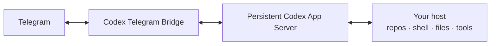

# Codex Telegram Bridge

> Part of **[Telegram AI](https://github.com/maleon17/telegram-ai)** — persistent Claude Code and Codex workflows controlled from Telegram.

**A persistent Codex engineering session in your Telegram chat.**

This project runs a real `codex app-server` on your Linux host and exposes it through a Telegram bot. Unlike wrappers that launch a fresh `codex exec` for every message, each Telegram user gets a persistent App Server process and resumable threads.

It uses your existing ChatGPT/Codex subscription through the installed Codex CLI, not a metered OpenAI API key.

## Why App Server instead of one-shot prompts?



The bridge keeps the engineering environment on the host where the repositories live. Telegram handles the human loop: give direction, watch progress, add context while a turn is active, interrupt it, resume an old thread, or receive the artifact when it is done.

## Highlights

- **Persistent Codex threads** — `/new`, `/sessions`, `/resume`.
- **Live work from the phone** — an editable progress card shows the active turn; completed turns arrive as normal Telegram messages with an optional collapsible process log.
- **Mid-turn input** — messages sent while Codex is working can be added to the active turn.
- **Clean interruption and compaction** — `/stop` maps to `turn/interrupt`; `/compact` starts native thread compaction.
- **Runtime controls** — model, reasoning effort, sandbox and workspace are selectable per user.
- **Detailed usage** — session tokens, context size, subscription limits and reset times.
- **Files and images** — Telegram images become Codex `localImage` inputs; generated files return through a scoped MCP outbox.
- **Multi-account isolation** — additional users receive their own `CODEX_HOME`, App Server process, credentials, sessions and usage.
- **Safe restarts** — restarts are deferred until active answers finish.
- **Message batching** — rapid messages and forwarded batches are combined rather than racing one another.
- **Rich-message context** — forwarded text and Telegram rich messages keep their source and content context.
- **Minimal runtime dependencies** — the bridge itself uses only Python's standard library.

## Requirements

- Linux with Python 3.10+ and `systemd`
- [Codex CLI](https://developers.openai.com/codex/cli/)
- Owner authenticated with `codex login`
- Telegram bot token from [@BotFather](https://t.me/BotFather)
- Numeric Telegram owner ID

## Quick install

```bash
git clone https://github.com/maleon17/codex-telegram-bridge.git
cd codex-telegram-bridge

codex login
chmod +x setup.sh
./setup.sh
```

Then verify:

```bash
./doctor.sh
journalctl -u codex-telegram-bot -f
```

The installer asks for the bot token, owner ID, default workspace, sandbox and service name. It stores the token in a mode-`600` `.env`, outside the systemd unit.

## Local Bot API server (optional)

The [cloud Bot API](https://core.telegram.org/bots/faq#handling-media) lets bots
download files up to 20 MB and upload files up to 50 MB. Optionally, `setup.sh`
can build and configure one shared, loopback-only
[`telegram-bot-api --local`](https://github.com/tdlib/telegram-bot-api) server.
The [local API](https://core.telegram.org/bots/api#using-a-local-bot-api-server)
removes Telegram's download limit, allows uploads up to 2,000 MB and lets the
bot use local file paths. The bridge itself defaults to 2,000 MiB limits for
both incoming and outgoing files (`INCOMING_FILE_MAX_BYTES` and
`FILE_SEND_MAX_BYTES`); Telegram's upload ceiling still applies. Files larger
than 20 MB therefore work in local mode. Leave the local-server question empty
and the bot continues to use `https://api.telegram.org` as before.

The installer builds a pinned official source revision, stores `api_id` and
`api_hash` only in a mode-`600` environment file, creates a systemd service and
a daily cleanup timer. It never asks for those credentials when a healthy shared
server already exists. Run its plan without changing the machine with:

```bash
scripts/install-local-bot-api.sh --dry-run
```

The shared-server settings may be overridden before invoking the installer:
`TELEGRAM_BOT_API_UNIT` (default `telegram-bot-api`),
`TELEGRAM_BOT_API_PORT` (default `8081`), `TELEGRAM_BOT_API_DIR` (default
`$HOME/.local/share/telegram-bot-api`), `TELEGRAM_BOT_API_ENV_FILE` (default
`$HOME/.config/telegram-bot-api/env`), `TELEGRAM_BOT_API_BIN`,
`TELEGRAM_BOT_API_REF`, and `TELEGRAM_BOT_API_RETENTION_DAYS` (default `7`).
The data directory is retained, while the cleanup timer removes files older
than the configured number of days.

After the installer is ready, setup verifies the bot against the cloud API,
asks for explicit confirmation, calls cloud `logOut`, then verifies the bot
through the local URL and writes `TELEGRAM_API_URL=http://127.0.0.1:<port>` to
the bot's `.env`. `logOut` is one-way for roughly 10 minutes: do not switch
back to the cloud API during that interval. The local server is deliberately
shared by projects on the same machine; each bot still has its own token.

To return to the cloud API, first log the bot out through its local API using a
credential-safe client, stop the bot, wait about 10 minutes, remove
`TELEGRAM_API_URL` from the bot's protected `.env`, and start the bot again.
Do not place a bot token in a shell command, service unit, or repository file.

## Commands

| Command | Description |
|---|---|
| `/language en\|ru\|uk\|kk\|de` | Set this chat's interface and persona language; update the Telegram command menu |
| `/persona` / `/persona reset` | Owner-only: show or reset the chat persona |
| `/new` | Start a new Codex thread |
| `/sessions` | List recent threads |
| `/resume <id>` | Resume by full ID or unique prefix |
| `/status` | Show thread, account, model, sandbox, workspace and busy state |
| `/stop` | Interrupt the active turn |
| `/compact` | Compact current thread context |
| `/usage` | Show session/context/subscription usage |
| `/model [id]` | Show/select model |
| `/effort [level]` | Show/select reasoning effort |
| `/mode read-only\|workspace-write\|full` | Select sandbox policy |
| `/workspace <path>\|default` | Select working directory |
| `/account` | Show current isolated Codex account |
| `/login` | Authenticate an additional user |
| `/restart` | Owner-only safe deferred restart |
| `/update` | Owner-only update + deferred restart |

## Multi-account model

The owner keeps the normal `~/.codex`. Add other users' numeric Telegram IDs to `whitelist.txt` (comma or newline separated); it is re-read on every update without a restart. On first contact, each additional user authenticates with the official device-code flow and receives isolated state under `accounts/<telegram_id>/`.

Each additional user gets independent credentials, subscription limits, App Server process, sessions, model/sandbox/workspace state, and active-turn state.

The bridge never asks users to paste Codex credentials into Telegram.

Removing an ID from `whitelist.txt` blocks new messages. Existing credentials remain on disk until you deliberately remove that user's account directory.

## File delivery

Generated files are returned through a tenant-scoped Telegram MCP tool. The agent places an artifact in `CODEX_TELEGRAM_OUTBOX` and calls `send_telegram_file`; only regular files from that user's outbox are accepted.

This keeps the bot token outside the agent process and prevents arbitrary filesystem paths from becoming Telegram attachments.

## Runtime data

These paths are intentionally ignored by Git:

| Path | Purpose |
|---|---|
| `.env` | Bot token and deployment configuration |
| `state.json` | Thread IDs, preferences and usage snapshots |
| `whitelist.txt` | Allowed Telegram users |
| `accounts/` | Isolated additional-user `CODEX_HOME` data |
| `restart.request` | Short-lived deferred-restart signal |

Treat `.env` and `accounts/` as secrets.

Stop the service before copying these paths for backup.

## Manual install

Run `codex login` as the Linux user that will run the service. Create `.env` with mode `600`:

```dotenv
TELEGRAM_BOT_TOKEN=123456:replace_me
OWNER_ID=123456789
CODEX_CWD=/home/your-user
CODEX_SANDBOX=danger-full-access
CODEX_BOT_STATE_FILE=/absolute/path/state.json
CODEX_BOT_WHITELIST_FILE=/absolute/path/whitelist.txt
CODEX_BOT_ACCOUNTS_DIR=/absolute/path/accounts
CODEX_BOT_RESTART_FILE=/absolute/path/restart.request
```

Copy `codex-telegram-bot.service.example` to `/etc/systemd/system/codex-telegram-bot.service`, replace `__USER__` and `__INSTALL_DIR__`, then:

```bash
sudo systemctl daemon-reload
sudo systemctl enable --now codex-telegram-bot.service
```

## Operations

```bash
systemctl status codex-telegram-bot
journalctl -u codex-telegram-bot -f
./doctor.sh
./request-restart
./update.sh
```

`/update` provides the Telegram-side update path. `git pull --ff-only` followed by `./request-restart` remains the shell fallback. The restart watcher edits its status message to “ready” after the new process starts.

## Security

`danger-full-access` gives Codex the permissions of the service's Linux user. Whitelist only people you trust and prefer `workspace-write` when host-wide access is unnecessary.

`NoNewPrivileges=true` prevents privilege escalation but does not isolate files already readable by the Unix user. Strong filesystem isolation requires separate Unix users or containers.

## Product boundary

This repository is the standalone Telegram Bot API frontend for Codex. The Telethon/userbot product is **[codex-ask](https://github.com/maleon17/codex-ask)** and deliberately has its own sessions/runtime.

The two applications do not import one another or share command queues. This bot's filesystem channels are private runtime transport for its own MCP/file delivery path.

See the **[Telegram AI hub](https://github.com/maleon17/telegram-ai)** for the complete ecosystem.

## Troubleshooting

- **Bot is silent:** run `./doctor.sh`, inspect the journal, verify the BotFather token and ensure no second process polls it.
- **Owner is unauthorized:** run `codex login status` as the service user.
- **Additional user cannot run Codex:** check `/account`, retry `/login`, and verify their account directory is writable.
- **Sandbox/bubblewrap warning:** Codex can use its bundled bubblewrap; installing the distro package removes the warning.
- **Rate limit reached:** `/usage` shows the active limit window and reset time.

## License

MIT, see [LICENSE](LICENSE). `telegram_format.py` is adapted from [hermes-agent](https://github.com/NousResearch/hermes-agent) under the MIT License.
